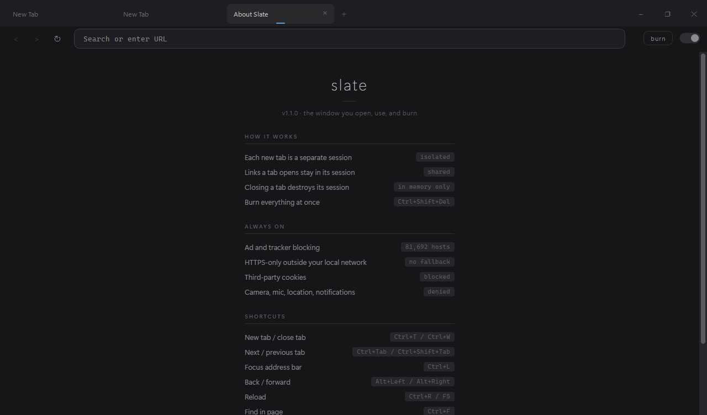

# Slate

The browser window you open, use, and burn.

Slate is a small Windows browser for one-off browsing: checking a link you do not trust, signing in to a second account, looking something up without it following you around. Every tab is its own throwaway session, nothing is written to disk, and one button destroys everything.

Built with C++17 and Qt 6 WebEngine (Chromium).



## How it works

- **Every tab is a separate session.** A tab you open gets its own in-memory profile: its own cookies, storage, and cache. Two tabs on the same site do not know about each other, so you can be signed in to two accounts side by side.
- **Links stay with their tab.** Tabs opened by a page (`target="_blank"`, sign-in popups) share the session of the tab that opened them, so sign-in flows keep working.
- **Closing a tab destroys its session.** There is no history, no session restore, and no "reopen closed tab".
- **Burn** (`Ctrl+Shift+Del` or the `burn` button) closes every tab and destroys every session at once.

## Always on

- **Ad and tracker blocking.** Requests to hosts on the [StevenBlack unified hosts list](https://github.com/StevenBlack/hosts) are blocked, with a per-session count in the toolbar. The list is downloaded on first run and refreshed weekly; a small built-in list covers the gap. Pages you navigate to yourself are never blocked.
- **HTTPS-only.** `http://` requests are upgraded to `https://` with no fallback. Local addresses (`localhost`, `127.0.0.1`, `192.168.x.x`, `*.local`) are exempt so dev servers and router pages work.
- **Third-party cookies blocked.**
- **Permissions denied.** Camera, microphone, location, notifications, and screen sharing requests are refused, with a notice saying so.
- **Downloads ask first.** Nothing is saved until you pick a location.
- **Untrusted certificates are refused**, with no click-through.
- **WebRTC does not expose local network addresses.**

## What Slate is not

- **Not an anonymity tool.** Sites still see your IP address, and Slate does nothing about browser fingerprinting. Use Tor Browser for that.
- **Not a daily driver.** No bookmarks, history, extensions, password manager, or sync, on purpose. Because permissions are always denied, video calls will not work.
- **Not as current as Chrome.** Slate uses the Chromium that ships with Qt, which trails upstream Chromium security patches by weeks to months. Do not use it for anything where a browser exploit is part of your threat model.
- **Host-based blocking only.** There is no cosmetic filtering, so ads served from the same host as the content (YouTube, for example) are not blocked.

The only thing Slate writes to disk is its cached copy of the blocklist, in `%LOCALAPPDATA%\Slate`.

## Install

Download the latest release from the [Releases](../../releases) page:

- **`Slate-<version>-windows.msi`** installs to `Program Files\Slate` with a Start Menu shortcut.
- **`Slate-<version>-windows.zip`** is portable: extract anywhere and run `Slate.exe`.

Both include everything Slate needs. The builds are not code-signed, so Windows SmartScreen will warn on first run; choose "More info" then "Run anyway".

## Keyboard shortcuts

| Shortcut | Action |
|----------|--------|
| `Ctrl+T` / `Ctrl+W` | New tab / close tab (and destroy its session) |
| `Ctrl+Shift+Del` | Burn: close every tab, destroy every session |
| `Ctrl+Tab` / `Ctrl+Shift+Tab` | Next / previous tab |
| `Ctrl+L` | Focus address bar |
| `Alt+Left` / `Alt+Right` | Back / forward |
| `Ctrl+R` or `F5` | Reload |
| `Ctrl+F` | Find in page |
| `Ctrl++` / `Ctrl+-` / `Ctrl+0` | Zoom in / out / reset |
| `Ctrl+P` | Save page as PDF |
| `F11` | Fullscreen |
| `F12` | Developer tools |
| `F1` | About and shortcut list |
| `Esc` | Exit fullscreen / close find bar |

## Custom blocklist

Put a `blocklist.txt` next to `Slate.exe` to block additional hosts. One entry per line, either a bare domain (`ads.example.com`) or hosts-file format (`0.0.0.0 ads.example.com`). `#` starts a comment. Subdomains of a listed domain are blocked too.

## Build from source

You need Visual Studio 2022 or later with the "Desktop development with C++" workload, and CMake 3.19+. Then, from PowerShell:

```powershell
.\build.ps1 -InstallQt
```

That downloads Qt 6.10 with WebEngine to `C:\Qt` (about 3 GB, one time, needs [uv](https://docs.astral.sh/uv/)), builds, runs the tests, and leaves a runnable copy in `dist\Slate` plus a portable zip. After the first run, plain `.\build.ps1` is enough.

- Already have Qt 6.8 or newer with WebEngine? Set `QT_PATH` (for example `C:\Qt\6.10.3\msvc2022_64`) and skip `-InstallQt`.
- `.\build.ps1 -Msi` also builds the installer. It needs [WiX Toolset v3](https://wixtoolset.org/docs/wix3/).

Every push is built and tested by GitHub Actions. Pushing a `v*` tag publishes the MSI and zip as a release.

## Code map

| File | What it does |
|------|--------------|
| `src/MainWindow.cpp` | Window chrome, tabs, and session lifetime |
| `src/RequestFilter.cpp` | Per-session request interceptor: HTTPS upgrade and blocking |
| `src/Blocklist.cpp` | Host set: built-in list, hosts-file parser, weekly refresh |
| `src/UrlInput.cpp` | Address bar text to URL or search |
| `src/TabBar.cpp` | Custom-painted tab bar |
| `src/pages/`, `src/styles/` | Internal pages and light/dark themes |
| `tests/tst_slate.cpp` | Tests for URL parsing and the blocklist |

## License

MIT. See [LICENSE](LICENSE).
